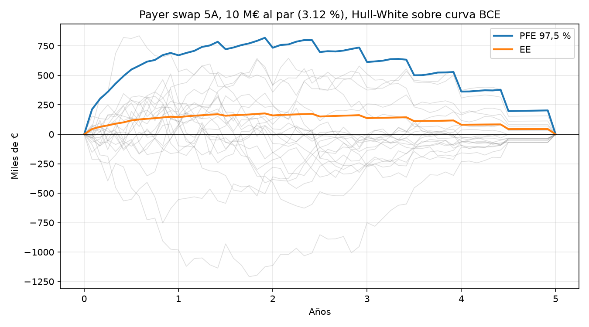
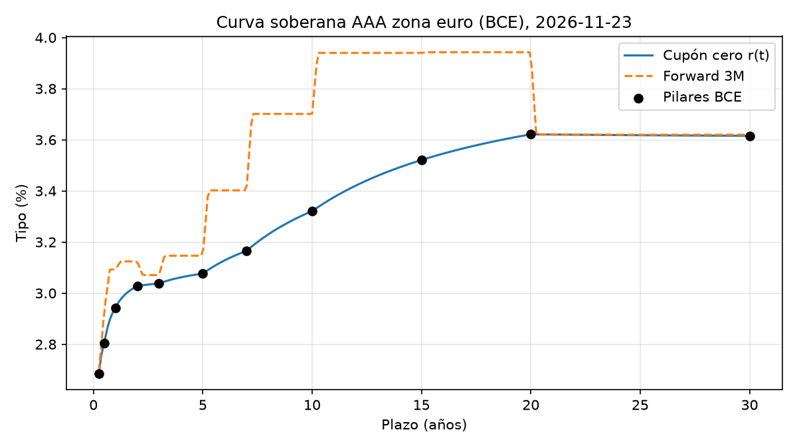
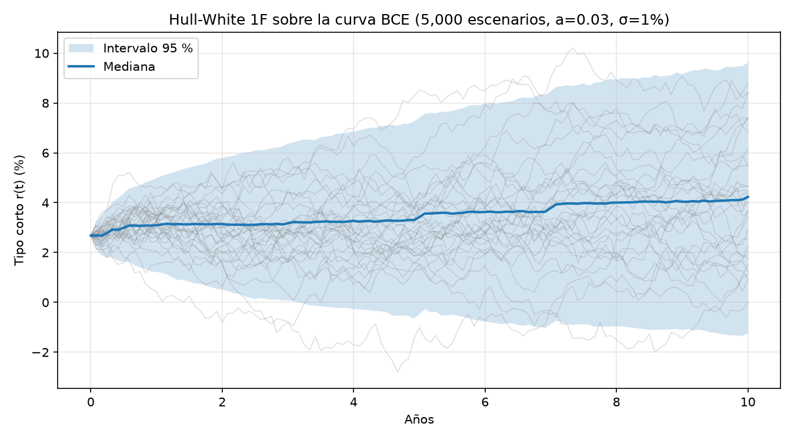
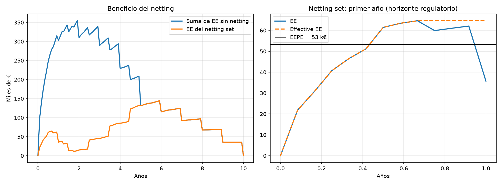

# CCR Exposure Engine

[](https://github.com/aleandradewo-collab/ccr-exposure-engine/actions/workflows/ci.yml)

An open-source counterparty credit risk (CCR) exposure engine built from scratch in Python,
inspired by the Internal Model Method (IMM) used by banks under the EU Capital Requirements
Regulation (CRR).

The engine simulates future market scenarios with Monte Carlo, prices a portfolio of
derivatives on every scenario and date, and computes the exposure metrics used for risk
limits and regulatory capital, up to the Exposure at Default (EAD) of a netting set. Every
module is backed by the underlying theory and tested against known analytical results.

> Built with public market data only (ECB yield curves) and public regulation (CRR, BCBS).
> Not affiliated with any financial institution.



*Expected Exposure (EE) and Potential Future Exposure (PFE) of a 5-year payer swap struck at
par, simulated with Hull-White on the latest ECB curve. The hump comes from two opposite
effects: rate uncertainty grows with time (diffusion), while each payment reduces the
remaining cash flows (amortisation).*

## Roadmap

- [x] Project structure, discount factors and CI
- [x] Yield curve from ECB data, log-linear interpolation and forward rates
- [x] Automated daily download of the ECB curve (GitHub Actions)
- [x] Pricing of interest rate swaps: legs, par rate, NPV and DV01
- [x] Hull-White 1F model: exact simulation and closed-form zero-coupon bonds
- [x] Swap valuation on simulated scenarios (exposure cube)
- [x] Exposure profiles: EE and PFE
- [x] Regulatory metrics: EPE, Effective EE, EEPE and EAD
- [x] Portfolios and netting sets
- [ ] Collateral (CSA thresholds, MTA, margin period of risk)
- [ ] Hull-White calibration and stressed EEPE
- [ ] Backtesting of the exposure model
- [ ] SA-CCR implementation and IMM vs SA-CCR capital comparison
- [ ] FX forwards

## What has been built so far

### 1. Market data: the ECB yield curve
The engine uses the euro area AAA-rated government bond yield curve published daily by the
European Central Bank (zero-coupon spot rates, continuous compounding).

- A scheduled GitHub Actions workflow downloads the latest curve every business day and
  commits it to `data/`, building a historical dataset for future calibration and backtesting.
- Between pillars, the curve interpolates `r(t)·t` linearly (equivalent to piecewise-constant
  instantaneous forward rates), which guarantees monotonically decreasing discount factors.



### 2. Interest rate swap pricing
Fixed-vs-floating swaps priced from discount factors:

- Fixed leg: `N · K · A`, where `A = Σ τᵢ P(0,Tᵢ)` is the annuity
- Floating leg: projected with forward rates, `N · Σ τᵢ F(0;Tᵢ₋₁,Tᵢ) P(0,Tᵢ)`
- Par rate, NPV and DV01 (bump-and-revalue)

Tests check the results against theory, e.g. the floating leg telescopes to
`N · (P(0,T₀) − P(0,Tₙ))`, a swap struck at par has zero value and payer and receiver are
exact opposites.

### 3. Hull-White one-factor model
The short rate is modelled as `r(t) = x(t) + φ(t)`, where `x` is an Ornstein-Uhlenbeck
process and `φ` fits today's curve exactly.

- **Exact simulation** of `x(t)` (no discretisation error), with seeds for reproducibility
- **Closed-form zero-coupon bonds** `P(t,T)` on every scenario: the whole future curve
  depends on a single state variable, which keeps the simulation cheap
- **Martingale tests:** the Monte Carlo average of the stochastic discount factor matches
  today's market prices within 4 standard errors, which validates the model end to end



### 4. Exposure simulation
Each swap is revalued on every simulated scenario and date, producing a
`dates × scenarios` matrix of values `V(t)` (the exposure cube). At each future date:

- Payments already made are excluded, which produces the saw-tooth shape of the profile.
- Future cash flows are discounted with the scenario's own curve `P(t,T)` from Hull-White.
- The floating coupon of the current period is already fixed, using the scenario's rate at
  the fixing date. The simulation grid therefore always includes all fixing dates.

From the cube, the engine computes:

| Metric | Definition | Use |
|---|---|---|
| **EE(t)** | `E[max(V(t), 0)]` | Basis for regulatory capital and CVA |
| **PFE(t)** | 97.5% quantile of `max(V(t), 0)` | Counterparty credit limits |

Validation includes a martingale test on the swap (`E[D(0,t)·V(t)] = V(0)` when no payments
occur in between, covering both already-fixed coupons and forward-starting swaps), the
identity `EE_payer − EE_receiver = E[V_payer]`, and a back-of-the-envelope check of the
peak exposure against `DV01 × σ√t`.

### 5. Netting sets and regulatory metrics
Trades with the same counterparty under a close-out netting agreement are valued on the
**same scenarios** and summed **before** taking the positive part:

```
E_netted(t) = max(Σ Vᵢ(t), 0)  ≤  Σ max(Vᵢ(t), 0)
```

The exposure profile of the netting set is then reduced to the regulatory figures of the
IMM (CRR Article 284):

| Metric | Definition |
|---|---|
| **EPE** | Time-weighted average of EE over the first year |
| **Effective EE** | Non-decreasing EE: `EffEE(tₖ) = max(EffEE(tₖ₋₁), EE(tₖ))`, capturing roll-over risk |
| **EEPE** | Time-weighted average of Effective EE over the first year (or the netting set's maturity, if shorter) |
| **EAD** | `α · EEPE`, with `α = 1.4` |

The example portfolio (a 5-year payer, a 10-year receiver and a 2-year payer with the same
counterparty) shows two key points: netting sharply reduces the EAD because opposite
positions offset each other in every scenario, and the one-year regulatory horizon can miss
exposure that builds up later in the life of the portfolio, which is why credit limits rely
on the full-life PFE rather than on EAD alone.



## Project structure

```
ccr-exposure-engine/
├── .github/workflows/
│   ├── ci.yml                  # lint + tests on every push
│   └── update-ecb-curve.yml    # daily download of the ECB curve
├── src/ccr_engine/
│   ├── curves.py               # YieldCurve: discounting, interpolation, forwards
│   ├── ecb.py                  # ECB data loading
│   ├── instruments.py          # InterestRateSwap
│   ├── hull_white.py           # HullWhite1F model
│   ├── exposure.py             # scenario valuation, netting sets, EE and PFE
│   └── regulatory.py           # EPE, Effective EE, EEPE and EAD (CRR Art. 284)
├── tests/                      # unit and statistical tests
├── scripts/                    # plots and examples
├── data/                       # ECB curves (updated automatically)
└── docs/                       # figures
```

## Installation

```bash
git clone https://github.com/aleandradewo-collab/ccr-exposure-engine.git
cd ccr-exposure-engine
python -m venv .venv
source .venv/bin/activate        # Windows: .venv\Scripts\activate
pip install -e ".[dev]"
pytest
```

## Usage

```bash
python scripts/plot_ecb_curve.py data/ecb_raw.csv   # plot the latest ECB curve
python scripts/price_swap.py                         # par rates and a sample swap valuation
python scripts/plot_hull_white.py                    # simulate and plot short-rate scenarios
python scripts/plot_exposure.py                      # EE and PFE profile of a 5-year swap
python scripts/portfolio_exposure.py                 # netting benefit, EEPE and EAD of a portfolio
```

## Modelling assumptions and limitations

This is an educational project; several simplifications are made on purpose and documented
here:

- **Single-curve framework:** the AAA government curve is used both to project and to
  discount cash flows. Banks use €STR (OIS) for discounting and Euribor curves for projection.
- **Simplified schedules:** equal accrual periods, no day-count conventions or business-day
  calendars, same frequency on both legs.
- **Hull-White 1F:** Gaussian (negative rates are possible) and one-factor (all maturities
  move together within a scenario).
- **Risk-neutral scenarios:** scenarios are currently simulated under the risk-neutral
  measure Q. IMM models often use real-world (P) dynamics for exposure, validated through
  backtesting.
- **Uncalibrated parameters:** mean reversion and volatility are currently illustrative
  (`a = 0.03`, `σ = 1%`). Calibration is on the roadmap.
- **No stressed EEPE yet:** the CRR requires EEPE to be computed with both current and
  stressed calibrations, taking the higher. This depends on calibration and is on the roadmap.
- **Default alpha:** `α = 1.4` is used; the CRR allows own estimates subject to supervisory
  approval and a floor of 1.2.
- **Uncollateralised exposure:** collateral is not modelled yet.
- **Interpolation:** piecewise-constant forwards cause small jumps in the model drift at curve
  pillars; a smoother scheme is a possible improvement.

## References

- Brigo, D. and Mercurio, F. (2006). *Interest Rate Models: Theory and Practice*. Springer.
- Gregory, J. (2020). *The xVA Challenge*. Wiley.
- Regulation (EU) No 575/2013 (CRR), Articles 283–294: Internal Model Method.
- European Central Bank: euro area yield curves.